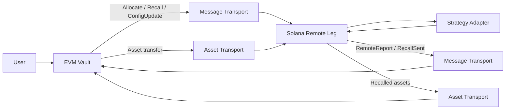

# SolEVM Vault

A Solana–EVM cross-chain asynchronous vault protocol with canonical accounting on EVM and a remote strategy execution leg on Solana.

## What this project does

Users interact with a vault on EVM. The EVM side owns the canonical shares, processes deposits and redemptions through asynchronous epochs, settles NAV and manages user claims. Capital may be allocated from the vault to a remote strategy leg on Solana.

The Solana leg custodies only the assets allocated to it. It never issues vault shares and has no direct relationship with depositors. The canonical EVM vault remains the sole authority on share ownership and liabilities.

Control messages (Allocate, Recall, ConfigUpdate) and asset transfers travel independently. A cross-chain message proves that a message arrived—it does not prove that the assets arrived. The protocol is designed around this separation.

> A cross-chain message proves that a message arrived. It does not prove that the assets arrived.

Reports (RemoteReport, RecallSent) flow back from Solana to the canonical side, carrying the remote leg's observed state for the hub to consume.

## Why this project exists

Cross-chain vault protocols must maintain consistent accounting while messaging and asset movement are asynchronous and failure-prone. This project explores the failure cases:

- Allocation message arrives before assets
- Assets arrive before the allocation message
- Partial asset arrival
- Duplicate or replayed delivery
- Delayed or reordered delivery
- Remote strategy loss
- Recall with partial liquidity
- Total-loss recall
- Remote leg freeze during unwind

The challenge is not cross-chain messaging itself—it is preserving correct accounting when the two transports (messages and assets) operate independently and can fail in different ways.

## Architecture



Message transport and asset transport are separate paths. The EVM vault is the canonical source of truth for shares and NAV. The Solana leg executes strategy operations and reports back.

In the current repository, transport and bridge execution are simulated deterministically. No real bridge is integrated.

## Components

### Rust accounting model

```
crates/accounting-model
```

A chain-independent deterministic reference model for deposits, redemptions, epoch settlement, claims, abort/refund behavior, rounding and dust handling.

### Protocol types

```
crates/protocol-types
```

Fixed-width canonical message encoding with Keccak message identifiers and commitment chaining. Defines Allocate, Recall, ConfigUpdate, RemoteReport and RecallSent message types.

### Cross-chain simulator

```
crates/xchain-sim
```

Models independent deterministic delivery of control messages and asset transfers. Injects faults: delay, drop, duplicate, reorder and partial asset delivery.

### Solidity vault

```
contracts/solevm-vault
```

The canonical EVM vault. ERC-20 vault shares with asynchronous deposit and redemption epochs. Pull-based claims with exact dust accounting. Pause and freeze behavior. Foundry fuzz and invariant testing.

This is not a drop-in ERC-4626 vault—the asynchronous epoch model differs from the synchronous preview/conversion interface of that standard.

### Rust-to-Solidity differential harness

```
crates/evm-differential
```

Generates deterministic scenarios from the Rust accounting model. The Foundry harness replays them against the Solidity vault and compares state after each operation.

### Solana remote leg

```
programs/solevm-remote-leg
```

An Anchor-based program that custodies SPL Token assets allocated from the EVM vault. Processes canonical Allocate and Recall messages with replay protection. Tracks transfer attribution, deployed principal and realized loss. Publishes RemoteReport and RecallSent messages through an ordered outbound lane.

The included strategy adapter is a deterministic test harness, not a production yield strategy.

## Key design decisions

### EVM owns canonical accounting

Only the EVM vault owns vault shares, user liabilities, canonical NAV, epoch settlement and finalized claims. The Solana leg has no authority over these.

### Solana owns only remote strategy state

The Solana leg tracks attributed remote principal, strategy deployment, custody balances, realized loss, recall state and unattributed assets. It does not know the vault's total NAV or share count.

### Message arrival is not asset receipt

Assets become attributed principal only after both the message and the assets are independently observed. A message alone does not increase remote principal.

### Remote profit is principal-capped in schema v1

The current report policy does not allow an unaudited remote report to create unrealized profit above the principal already allocated. This is intentional for the initial schema.

### One unresolved remote transfer cycle

The current implementation permits only one unresolved allocation or recall cycle at a time, simplifying accounting and state tracking.

### Freeze allows safe unwind

Freezing the remote leg prevents new exposure while allowing an already accepted recall to continue withdrawing, sending and reporting.

## Protocol flows

### Allocation

```
EVM allocation request
→ canonical Allocate message
→ Solana accepts message
→ assets arrive independently
→ assets become attributed only after observed receipt
→ capital may be deployed to the configured strategy
```

### Recall

```
canonical Recall message
→ available Solana custody reserved
→ remaining principal withdrawn from strategy
→ realized loss measured from observable state
→ recovered assets sent to fixed outbound escrow
→ RecallSent published
```

### Reporting

```
Solana state observation
→ RemoteReport built from on-chain state
→ canonical fixed-width encoding
→ ordered outbound commitment chain
```

## Testing

The repository uses multiple verification approaches:

- Rust unit and property tests for the accounting model, protocol types and simulator
- Foundry unit tests for the Solidity vault
- Foundry fuzz tests for boundary conditions
- Foundry stateful invariant tests with multi-actor scenarios
- Rust-to-Solidity differential testing comparing model and contract state
- LiteSVM instruction tests for the Solana program
- Mollusk compute regression tests for instruction cost
- Golden-vector protocol tests for canonical message encoding
- Deterministic transport fault simulation

All current test suites pass.

## Security properties exercised

The test suites exercise properties including:

- Message receipt alone cannot increase remote principal
- Unattributed assets remain outside accepted principal
- Replay cannot execute a message twice
- Strategy CPI is restricted to configured program and accounts
- Same-epoch EVM deposits cannot fund same-epoch redemptions
- Claims remain pull-based
- Total-loss recall remains representable
- Freeze blocks new remote exposure while preserving safe unwind
- Reported remote value cannot exceed schema-v1 principal policy
- Failed publication does not consume an outbound sequence

## Repository structure

```
.
├── crates/
│   ├── accounting-model/
│   ├── protocol-types/
│   ├── xchain-sim/
│   └── evm-differential/
├── contracts/
│   └── solevm-vault/
└── programs/
    └── solevm-remote-leg/
```

## Running the project

### Rust

Requires Rust 1.90 or newer.

```bash
cargo fmt --all --check
cargo check --workspace --all-targets
cargo clippy --workspace --all-targets --all-features -- -D warnings
cargo test --workspace --all-features
```

Property tests with higher case counts:

```bash
PROPTEST_CASES=250000 cargo test --release -p accounting-model --test properties
PROPTEST_CASES=250000 cargo test --release -p protocol-types --test properties
PROPTEST_CASES=250000 cargo test --release -p xchain-sim --test properties
```

### Solidity

Install Foundry, then from `contracts/solevm-vault`:

```bash
forge install foundry-rs/forge-std@v1.16.2 --no-git --shallow
forge install OpenZeppelin/openzeppelin-contracts@v5.7.0 --no-git --shallow

forge fmt --check
forge build
forge test
```

Extended fuzz and invariant runs:

```bash
FOUNDRY_PROFILE=soak forge test
```

### Solana

From `programs/solevm-remote-leg`:

```bash
cargo-build-sbf --tools-version v1.54

cargo fmt --all --check
cargo check --workspace --all-targets
cargo clippy --workspace --all-targets --all-features -- -D warnings
cargo test --workspace --all-features
```

### Differential testing

From `contracts/solevm-vault`:

```bash
RUN_DIFFERENTIAL=1 FOUNDRY_PROFILE=differential \
  forge test --match-contract RustModelDifferentialTest -vv
```

Expand the run:

```bash
RUN_DIFFERENTIAL=1 DIFF_SEED=1 DIFF_CASES=512 DIFF_STEPS=5 \
  FOUNDRY_PROFILE=differential \
  forge test --match-contract RustModelDifferentialTest -vv
```

Inspect scenarios without Foundry:

```bash
cargo run -p evm-differential -- --seed 1 --cases 64 --steps 4 --stats
cargo run -p evm-differential -- --seed 1 --cases 64 --steps 4 --describe 12
```

## Scope and limitations

- No real bridge is integrated; cross-chain transport is deterministic simulation
- No production oracle is integrated
- No production Solana yield strategy is included
- No keeper or indexer is required for the current test architecture
- The system has not been audited
- The repository is not presented as production-ready
- One unresolved remote allocation or recall cycle is supported
- Classic SPL Token is supported by the Solana leg, not Token-2022

## Next

- Deterministic end-to-end cross-chain scenarios
- Packaging and release documentation

## License

This project is licensed under the Apache License 2.0. See [LICENSE](LICENSE).

## Author

Ayush Kumar Mishra
