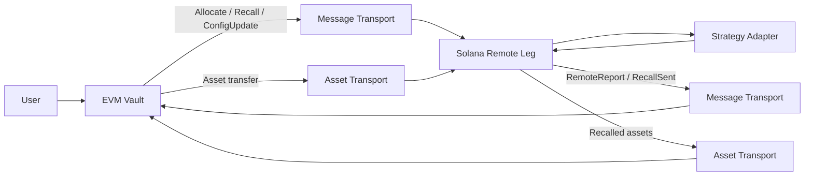

# SolEVM Vault

A Solana–EVM cross-chain asynchronous vault protocol with canonical accounting on EVM and a remote strategy execution leg on Solana.

## What this project does

Users interact with a vault on EVM. The EVM side owns the canonical shares, user liabilities, epochs, NAV, claims and remote-leg accounting. Capital may be allocated from the vault to a remote strategy leg on Solana.

The Solana leg custodies only the assets allocated to it. It never issues vault shares and has no direct relationship with depositors. The canonical EVM vault remains the sole authority on share ownership and liabilities.

Control messages (Allocate, Recall, ConfigUpdate) and asset transfers travel independently.

> A cross-chain message proves that a message arrived. It does not prove that the assets arrived.

Reports (RemoteReport, RecallSent) flow back from Solana to the canonical side, carrying the remote leg's observed state for the hub to consume.

## Why this project exists

Cross-chain vault protocols must maintain consistent accounting while messaging and asset movement are asynchronous and failure-prone. This project explores the failure cases:

- Allocation message arrives before assets
- Assets arrive before the allocation message
- Partial asset arrival
- Duplicate or replayed delivery
- Delayed or reordered delivery
- Remote strategy loss
- Recall with partial liquidity
- Total-loss recall
- Remote leg freeze during unwind

The challenge is not cross-chain messaging itself—it is preserving correct accounting when the two transports (messages and assets) operate independently and can fail in different ways.

## Architecture



Message transport and asset transport are separate paths. The EVM vault is the canonical source of truth for shares, user liabilities and NAV, including remote capital. The Solana leg executes strategy operations and reports back. It does not own shares or canonical NAV.

In the current repository, transport is simulated deterministically. No real bridge is integrated.

## Components

### Rust accounting model

```
crates/accounting-model
```

A chain-independent deterministic reference model for deposits, redemptions, epoch settlement, claims, abort/refund behavior, rounding and dust handling.

### Protocol types

```
crates/protocol-types
```

Fixed-width canonical message encoding with Keccak message identifiers and commitment chaining. Defines Allocate, Recall, ConfigUpdate, RemoteReport and RecallSent message types.

### Cross-chain simulator

```
crates/xchain-sim
```

Models independent deterministic delivery of control messages and asset transfers. Injects faults: delay, drop, duplicate, reorder and partial asset delivery.

### Solidity vault

```
contracts/solevm-vault
```

The canonical EVM vault and its cross-chain accounting. ERC-20 vault shares with asynchronous deposit and redemption epochs. Pull-based claims with exact dust accounting. Pause and freeze behavior. Canonical NAV includes idle backing, outbound transit, principal-capped remote value and inbound transit. Realized remote loss reduces that value. Foundry fuzz and invariant testing.

This is not a drop-in ERC-4626 vault—the asynchronous epoch model differs from the synchronous preview/conversion interface of that standard. The EVM contracts do not execute Solana strategy logic.

### Rust-to-Solidity differential harness

```
crates/evm-differential
```

Generates deterministic scenarios from the Rust accounting model. The Foundry harness replays them against the Solidity vault and compares state after each operation.

### Solana remote leg

```
programs/solevm-remote-leg
```

An Anchor-based program that custodies SPL Token assets allocated from the EVM vault. Accepts Allocate, Recall and ConfigUpdate on one inbound control lane with commitment chaining and replay protection. Tracks attributed custody, deployed strategy principal, recalls, realized loss, unattributed assets and outbound reporting state. Publishes RemoteReport and RecallSent on an ordered outbound lane.

The included strategy adapter is a deterministic test harness, not a production yield strategy.

### Full-system E2E

```
contracts/solevm-vault/test/e2e
programs/solevm-remote-leg/e2e
```

Deterministic scenarios that connect the live EVM vault, independent message and asset transport, the live Solana remote leg, the strategy adapter, RemoteReport / RecallSent and EVM cross-chain accounting. Foundry runs the Solidity contracts; LiteSVM runs the Solana program; xchain-sim schedules the two transports; protocol-types supplies the canonical encoding. Orchestration crosses process boundaries through a deterministic FFI harness.

## Key design decisions

### EVM owns canonical accounting

Only the EVM vault owns vault shares, user liabilities, epochs, canonical NAV, finalized claims, outbound transit, remote accounting, inbound transit and realized remote loss. The Solana leg has no authority over these.

### Solana owns only remote strategy state

The Solana leg tracks attributed custody, deployed strategy principal, recalls, realized loss, unattributed assets and outbound reporting state. It does not know the vault's total NAV or share count.

### Message arrival is not asset receipt

Assets become attributed principal only after both the message and the assets are independently observed. A message alone does not increase remote principal. RecallSent is not EVM asset receipt.

### One inbound control lane

Allocate, Recall and ConfigUpdate share the configured EVM→Solana control lane: one ordered sequence and one commitment chain. A consumed sequence cannot be reused by another message type.

### Remote profit is principal-capped in schema v1

Accepted remote capital contributes to canonical value and is principal-capped under schema v1. Unrealized remote profit is not supported. Outbound transit remains accounted for while capital leaves EVM. After RecallSent, inbound transit remains accounted for until the assets are observed on EVM. Realized remote loss reduces canonical value.

### One unresolved remote transfer cycle

The current implementation permits only one unresolved allocation or recall cycle at a time, simplifying accounting and state tracking.

### Freeze allows safe unwind

Freezing the remote leg prevents new exposure while allowing an already accepted recall to continue withdrawing, sending and reporting. Freeze is terminal. Principal that was not under recall when the leg froze can still return home, but only with the emergency guardian's co-signature: a frozen leg accepts a recall, or attributes an allocation accepted before the freeze, only when the guardian co-signs. Deploys, new allocations and configuration changes stay blocked.

### Adapters never hold custody signing power

The leg moves assets into the adapter vault itself and signs adapter calls with a dedicated caller identity that owns nothing. After every adapter call the leg checks the balance and principal deltas and requires custody to answer to the custody authority alone, with no delegate or close authority. Any violation reverts the whole transaction.

### Initialization is reserved to the upgrade authority

Only the program's upgrade authority can initialize a deployment and vault namespace, so no one can claim a deployment ahead of its operator. A program made immutable can no longer initialize new namespaces.

## Protocol flows

### Allocation

```
EVM allocation request
→ canonical Allocate message
→ Solana accepts message
→ assets arrive independently
→ assets become attributed only after observed receipt
→ capital may be deployed to the configured strategy
```

### Recall

```
canonical Recall message
→ available Solana custody reserved
→ remaining principal withdrawn from strategy
→ realized loss measured from observable state
→ recovered assets sent to fixed outbound escrow
→ RecallSent published
→ EVM inbound transit updates
→ recalled assets arrive independently
```

### Reporting

```
Solana state observation
→ RemoteReport built from on-chain state
→ canonical fixed-width encoding
→ ordered outbound commitment chain
→ EVM consumes each report in order
→ a report that can no longer price advances the lane and emits RemoteReportSkipped
```

A report can no longer price once it has expired, when it names another epoch or an observation older than the cutoff while the epoch is at cutoff, or after the epoch's valuation is fixed, unless it only completes the open allocation without moving NAV. Integrity failures still revert. RecallSent never expires.

## Testing

The repository uses multiple verification approaches:

- Rust unit and property tests for the accounting model, protocol types and simulator
- Foundry unit tests for the Solidity vault
- Foundry fuzz tests for boundary conditions
- Foundry stateful invariant tests with multi-actor scenarios
- Rust-to-Solidity differential testing comparing model and contract state
- LiteSVM instruction tests for the Solana program
- Mollusk compute regression tests for instruction cost
- Golden-vector protocol tests for canonical message encoding
- Deterministic transport fault simulation
- Deterministic cross-chain E2E scenarios

The E2E suite exercises live EVM production contracts and live Solana remote-leg instructions with exact canonical payloads. Message and asset transport stay independent. Scenarios cover the healthy allocation and recall path plus delay, reorder, duplication, drop, partial loss, total loss and freeze during unwind.

All current test suites pass.

## Security properties exercised

The test suites exercise properties including:

- Message receipt alone cannot increase remote principal
- Asset arrival alone cannot authorize remote principal
- Unattributed custody is excluded from accepted principal
- Replay cannot execute financial state twice
- Same control-lane sequence cannot be reused across message types
- Strategy CPI is restricted to configured program and accounts
- A hostile adapter cannot take custody ownership, approve a delegate, set a close authority, drain custody or misreport principal
- The replay watermark cannot pass an unresolved transfer, and the position cannot be left out
- Only the upgrade authority can initialize a deployment namespace
- A frozen leg releases principal only with the guardian's co-signature
- Reports published during a recall price against the recall's baseline, net of realized loss
- Same-epoch EVM deposits cannot fund same-epoch redemptions
- Claims remain pull-based
- RecallSent is separate from EVM asset receipt
- Realized loss is applied once
- Total-loss recall remains representable
- Freeze blocks new remote exposure while preserving safe unwind
- Failed publication does not consume an outbound sequence
- Principal-capped remote reports cannot create schema-v1 unrealized profit
- Financial buckets do not double-count value

## Repository structure

```
.
├── crates/
│   ├── accounting-model/
│   ├── protocol-types/
│   ├── xchain-sim/
│   └── evm-differential/
├── contracts/
│   └── solevm-vault/
└── programs/
    └── solevm-remote-leg/
```

## Running the project

### Rust

Requires Rust 1.90 or newer.

```bash
cargo fmt --all --check
cargo check --workspace --all-targets
cargo clippy --workspace --all-targets --all-features -- -D warnings
cargo test --workspace --all-features
```

Property tests with higher case counts:

```bash
PROPTEST_CASES=250000 cargo test --release -p accounting-model --test properties
PROPTEST_CASES=250000 cargo test --release -p protocol-types --test properties
PROPTEST_CASES=250000 cargo test --release -p xchain-sim --test properties
```

### Solidity

Install Foundry, then from `contracts/solevm-vault`. The default suite includes the cross-chain E2E tests, which need the Solana SBF artifacts from the next section.

```bash
forge install foundry-rs/forge-std@v1.16.2 --no-git --shallow
forge install OpenZeppelin/openzeppelin-contracts@v5.7.0 --no-git --shallow

forge fmt --check
forge build
forge test
```

Extended fuzz and invariant runs:

```bash
FOUNDRY_PROFILE=soak forge test
```

### Solana

Requires `cargo-build-sbf` 4.4.0 (`cargo install cargo-build-sbf --version 4.4.0 --locked`), which fetches platform-tools v1.58 on first use. From `programs/solevm-remote-leg`:

```bash
cargo-build-sbf --tools-version v1.58 --arch v0
cargo-build-sbf --tools-version v1.58 --arch v0 --manifest-path test-strategy/Cargo.toml --sbf-out-dir target/deploy
cargo-build-sbf --tools-version v1.58 --arch v0 --manifest-path test-strategy/Cargo.toml --features hostile --sbf-out-dir target/deploy-hostile

cargo fmt --all --check
cargo check --locked --workspace --all-targets
cargo clippy --locked --workspace --all-targets --all-features -- -D warnings
cargo test --locked --workspace --all-features
```

The `hostile` build is the misbehaving adapter that `tests/hostile_adapter.rs` loads. The artifacts above are SBPFv0. To check the program under SBPFv3 separately:

```bash
cargo-build-sbf --tools-version v1.58 --arch v3 --sbf-out-dir target/deploy-v3
cargo-build-sbf --tools-version v1.58 --arch v3 --manifest-path test-strategy/Cargo.toml --sbf-out-dir target/deploy-v3
cargo-build-sbf --tools-version v1.58 --arch v3 --manifest-path test-strategy/Cargo.toml --features hostile --sbf-out-dir target/deploy-hostile-v3

SBF_OUT_DIR=$PWD/target/deploy-v3 HOSTILE_SBF_OUT_DIR=$PWD/target/deploy-hostile-v3 \
  cargo test --locked --workspace --all-features
```

### Cross-chain E2E

Requires Python 3, Cargo and both Solana SBF artifacts from the Solana section. From `contracts/solevm-vault`:

```bash
forge test --match-contract CrossChainE2ETest
```

From `programs/solevm-remote-leg`:

```bash
cargo test -p solevm-e2e
```

### Differential testing

From `contracts/solevm-vault`:

```bash
RUN_DIFFERENTIAL=1 FOUNDRY_PROFILE=differential \
  forge test --match-contract RustModelDifferentialTest -vv
```

Expand the run:

```bash
RUN_DIFFERENTIAL=1 DIFF_SEED=1 DIFF_CASES=512 DIFF_STEPS=5 \
  FOUNDRY_PROFILE=differential \
  forge test --match-contract RustModelDifferentialTest -vv
```

Inspect scenarios without Foundry:

```bash
cargo run -p evm-differential -- --seed 1 --cases 64 --steps 4 --stats
cargo run -p evm-differential -- --seed 1 --cases 64 --steps 4 --describe 12
```

## Scope and limitations

- No real bridge is integrated; cross-chain transport is deterministic simulation
- No production oracle is integrated
- No production Solana yield strategy is included
- No keeper or indexer is required for the current test architecture
- The EVM test environment uses a test authenticator rather than a real bridge authenticator
- The system has not been audited
- The repository is not presented as production-ready
- One unresolved remote allocation or recall cycle is supported
- Classic SPL Token is supported by the Solana leg, not Token-2022
- Allocation and recall minimums and deadlines are encoded and structurally validated but advisory: the Solana leg completes an allocation only at its full authorized amount and enforces neither the recall minimum nor either deadline
- An expired control message halts the Solana control lane, and a partially delivered or dropped allocation stays open. Recovering from either needs an explicit resolution message that is not yet designed

## License

This project is licensed under the Apache License 2.0. See [LICENSE](LICENSE).

## Author

Ayush Kumar Mishra
