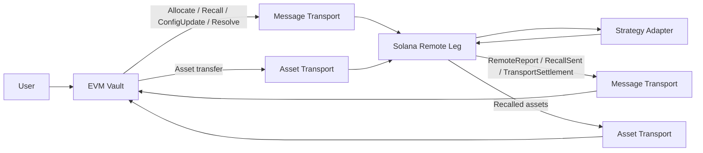

# SolEVM Vault

A Solana–EVM cross-chain asynchronous vault protocol with canonical accounting on EVM and a remote strategy execution leg on Solana.

## What this project does

Users interact with a vault on EVM. The EVM side owns the canonical shares, user liabilities, epochs, NAV, claims and remote-leg accounting. Capital may be allocated from the vault to a remote strategy leg on Solana.

The Solana leg custodies only the assets allocated to it. It never issues vault shares and has no direct relationship with depositors. The canonical EVM vault remains the sole authority on share ownership and liabilities.

Control messages (Allocate, Recall, ConfigUpdate, Resolve) and asset transfers travel independently.

> A cross-chain message proves that a message arrived. It does not prove that the assets arrived.

Reports (RemoteReport, RecallSent, TransportSettlement) flow back from Solana to the canonical side, carrying the remote leg's observed state and settlements for the hub to consume.

## Why this project exists

Cross-chain vault protocols must maintain consistent accounting while messaging and asset movement are asynchronous and failure-prone. This project explores the failure cases:

- Allocation message arrives before assets
- Assets arrive before the allocation message
- Partial asset arrival
- An allocation deadline that passes before all assets arrive
- Assets that arrive after their allocation was closed
- Duplicate or replayed delivery
- Delayed or reordered delivery
- Control messages that expire or cannot run when they arrive
- Remote strategy loss
- Recall with partial liquidity
- Total-loss recall
- Remote leg freeze during unwind

The challenge is not cross-chain messaging itself—it is preserving correct accounting when the two transports (messages and assets) operate independently and can fail in different ways.

## Architecture



Message transport and asset transport are separate paths. The EVM vault is the canonical source of truth for shares, user liabilities and NAV, including remote capital. The Solana leg executes strategy operations and reports back. It does not own shares or canonical NAV.

In the current repository, transport is simulated deterministically. No real bridge is integrated.

## Components

### Rust accounting model

```
crates/accounting-model
```

A chain-independent deterministic reference model for deposits, redemptions, epoch settlement, claims, abort/refund behavior, rounding and dust handling.

### Protocol types

```
crates/protocol-types
```

Fixed-width canonical message encoding with Keccak message identifiers and commitment chaining. Every message is a 247-byte header followed by a fixed-size body. The Solidity codec produces the same bytes, identifiers and commitments.

| Type | Message | Direction | Purpose |
| --- | --- | --- | --- |
| 1 | Allocate | EVM → Solana | Authorizes one allocation of a fixed amount |
| 2 | Recall | EVM → Solana | Requests principal back |
| 3 | RemoteReport | Solana → EVM | Observed remote state, for valuation and completion |
| 4 | RecallSent | Solana → EVM | Principal resolved, assets sent and realized loss of a recall |
| 5 | ConfigUpdate | EVM → Solana | Risk parameter change; the EVM coordinator does not originate it |
| 6 | Resolve | EVM → Solana | Admits, closes or recovers against a named transfer |
| 7 | TransportSettlement | Solana → EVM | The one settlement of a close or a recovery |

A Resolve body (49 bytes) carries the transfer id, the sequence of the message it targets, an action (1 Admit, 2 Close, 3 Recover) and the config version. A TransportSettlement body (89 bytes) carries the transfer id, a kind (1 Closed, 2 Recovered), the claim, the credited amount, the impairment still outstanding after it, and the config version. Decoding rejects unknown actions and kinds, a zero claim, a credit above the claim, a close whose outstanding impairment is below its own shortfall, and a recovery whose outstanding impairment is not exactly the claim minus the credit.

### Cross-chain simulator

```
crates/xchain-sim
```

Models independent deterministic delivery of control messages and asset transfers. Injects faults: delay, drop, duplicate, reorder and partial asset delivery.

### Solidity vault

```
contracts/solevm-vault
```

The canonical EVM vault and its cross-chain accounting. ERC-20 vault shares with asynchronous deposit and redemption epochs. Pull-based claims with exact dust accounting. Pause and freeze behavior. Canonical NAV includes idle backing, outbound transit, principal-capped remote value and inbound transit. Realized remote loss reduces that value. Foundry fuzz and invariant testing.

This is not a drop-in ERC-4626 vault—the asynchronous epoch model differs from the synchronous preview/conversion interface of that standard. The EVM contracts do not execute Solana strategy logic.

### Rust-to-Solidity differential harness

```
crates/evm-differential
```

Generates deterministic scenarios from the Rust accounting model. The Foundry harness replays them against the Solidity vault and compares state after each operation.

### Solana remote leg

```
programs/solevm-remote-leg
```

An Anchor-based program that custodies SPL Token assets allocated from the EVM vault. Accepts Allocate, Recall, ConfigUpdate and Resolve on one inbound control lane with commitment chaining and replay protection. Tracks attributed custody, deployed strategy principal, recalls, realized loss, unattributed assets, quarantined transfers, pooled transport impairment and outbound reporting state. Publishes RemoteReport, RecallSent and TransportSettlement on an ordered outbound lane.

The included strategy adapter is a deterministic test harness, not a production yield strategy.

### Full-system E2E

```
contracts/solevm-vault/test/e2e
programs/solevm-remote-leg/e2e
```

Deterministic scenarios that connect the live EVM vault, independent message and asset transport, the live Solana remote leg, the strategy adapter, RemoteReport / RecallSent and EVM cross-chain accounting. Foundry runs the Solidity contracts; LiteSVM runs the Solana program; xchain-sim schedules the two transports; protocol-types supplies the canonical encoding. Orchestration crosses process boundaries through a deterministic FFI harness.

## Key design decisions

### EVM owns canonical accounting

Only the EVM vault owns vault shares, user liabilities, epochs, canonical NAV, finalized claims, outbound transit, remote accounting, inbound transit and realized remote loss. The Solana leg has no authority over these.

### Solana owns only remote strategy state

The Solana leg tracks attributed custody, deployed strategy principal, recalls, realized loss, unattributed assets and outbound reporting state. It does not know the vault's total NAV or share count.

### Message arrival is not asset receipt

Assets become attributed principal only after both the message and the assets are independently observed. A message alone does not increase remote principal. RecallSent is not EVM asset receipt.

### One inbound control lane

Allocate, Recall, ConfigUpdate and Resolve share the configured EVM→Solana control lane: one ordered sequence and one commitment chain. A consumed sequence cannot be reused by another message type. A Resolve always targets an earlier sequence on the same lane, so the leg has already accepted or quarantined its target when the Resolve arrives.

### Remote profit is principal-capped in schema v1

Accepted remote capital contributes to canonical value and is principal-capped under schema v1. Unrealized remote profit is not supported. Outbound transit remains accounted for while capital leaves EVM. After RecallSent, inbound transit remains accounted for until the assets are observed on EVM. Realized remote loss reduces canonical value.

### One unresolved remote transfer cycle

The current implementation permits only one unresolved allocation, recall or recovery cycle at a time, simplifying accounting and state tracking.

### Blocked control messages are quarantined

An authentic, in-order Allocate or Recall that cannot run is consumed with no financial effect and held as quarantined, so the control lane keeps moving and the obligation stays visible. An allocation is quarantined when it has expired, when the leg is frozen or when it would exceed the principal ceiling. A recall is quarantined when it has expired. A quarantined transfer remains the open cycle until a Resolve settles it: Admit runs it on its original terms, and a quarantined allocation can instead be closed, crediting nothing.

### A timeout is not a loss

An allocation whose deadline passes is not presumed lost, because its assets may still be in transit. After the deadline, the EVM administrator may ask the leg to close it with `RemoteAccounting.close`. The request itself moves no value. The leg ends the allocation at what custody explains and publishes a TransportSettlement in the same instruction. Only that settlement changes EVM accounting. The leg credits:

- a pending allocation with the custody that already arrived for it, up to its outstanding amount
- a quarantined allocation with nothing, because it was never admitted
- an allocation that completed before the close, but whose completion the EVM had not yet applied, in full

For a claim of `A` of which `a` was credited, the vault moves `A` out of outbound transit, adds `a` to the remote principal cap and to accepted remote value, and adds `A − a` to `impairedTransport`. NAV falls by `A − a` and `recognizedLoss` does not change. A full credit settles exactly like a completion. Until the settlement lands, the coordinator skips every report and refuses Admit, so no report can complete or price the closing allocation first. The settlement is the only path that ends a closing allocation.

### Impairment stays outside NAV

`impairedTransport` is closed shortfall that has not been recovered. It is excluded from NAV and kept apart from `recognizedLoss`: a transport shortfall is not a realized strategy loss and is never written off automatically. The leg keeps the same figure in a pooled transport ledger, where every closed claim is credited, still impaired or recovered, exactly once:

```
closed claims = closed credits + impairment outstanding + recovered
```

Every TransportSettlement carries the leg's outstanding impairment, and the coordinator reverts unless it matches its own figure, so the two chains cannot drift apart. An epoch price locked before a close is not changed by it.

### Recovery is pooled

Custody is one fungible token account, so an asset that arrives after its allocation closed cannot be traced back to that allocation. A recovery, started with `RemoteAccounting.recover`, therefore draws on the impaired pool rather than on a transfer. It requires that no cycle is open and that impairment is outstanding, and it uses its own fresh transfer id and transfer record, never a closed allocation's. It names the last allocation closed short, which binds it to the impairment state the EVM saw. The leg reconciles custody, then credits the smallest of:

- unattributed custody
- outstanding impairment
- the principal ceiling minus attributed, deployed and recalled-custody principal

The vault returns the credited amount to remote principal at par: `impairedTransport` falls by that amount, and the remote principal cap and accepted remote value rise by it. A recovery that finds nothing still settles, crediting zero, and ends its cycle.

### Freeze allows safe unwind

Freezing the remote leg prevents new exposure while allowing an already accepted recall to continue withdrawing, sending and reporting. Freeze is terminal. Principal that was not under recall when the leg froze can still return home, but only with the emergency guardian's co-signature. Deploys and configuration changes stay blocked, and a new allocation is quarantined.

### Guardian authority

The emergency guardian holds no EVM authority and cannot start anything. Admit, Close and Recover originate only from the EVM administrator through the coordinator, and only the configured transport verifier can submit them on Solana. On a frozen leg, these additionally need the guardian's co-signature:

- accepting a recall
- attributing an allocation accepted before the freeze
- admitting a quarantined transfer
- closing an allocation
- recovering impairment

Without the co-signature they revert. A control message that reverts stays unconsumed, so the ordered control lane waits for the guardian. A frozen leg recovers through the same steps as an active one, each co-signed: close the short allocation, recover late custody into principal, then recall that principal home.

### Adapters never hold custody signing power

The leg moves assets into the adapter vault itself and signs adapter calls with a dedicated caller identity that owns nothing. After every adapter call the leg checks the balance and principal deltas and requires custody to answer to the custody authority alone, with no delegate or close authority. Any violation reverts the whole transaction.

### Initialization is reserved to the upgrade authority

Only the program's upgrade authority can initialize a deployment and vault namespace, so no one can claim a deployment ahead of its operator. A program made immutable can no longer initialize new namespaces.

## Protocol flows

### Allocation

```
EVM allocation request
→ canonical Allocate message
→ Solana accepts message
→ assets arrive independently
→ assets become attributed only after observed receipt
→ capital may be deployed to the configured strategy
```

### Recall

```
canonical Recall message
→ available Solana custody reserved
→ remaining principal withdrawn from strategy
→ realized loss measured from observable state
→ recovered assets sent to fixed outbound escrow
→ RecallSent published
→ EVM inbound transit updates
→ recalled assets arrive independently
```

### Quarantine and admission

```
Allocate or Recall that cannot run arrives in order
→ consumed and held as quarantined, with no financial effect
→ EVM administrator sends Resolve (Admit) naming its sequence
→ the transfer runs on its original terms
```

### Close

```
allocation deadline passes with assets missing
→ EVM administrator sends Resolve (Close); no value moves
→ EVM skips reports until the settlement
→ Solana attributes custody that already arrived, then closes the allocation
→ TransportSettlement (Closed) published in the same instruction
→ EVM credits what arrived and records the rest as impairment
```

### Recovery

```
late assets arrive in Solana custody and stay unattributed
→ EVM administrator sends Resolve (Recover) under a fresh transfer id
→ Solana reconciles custody and credits it against the impaired pool, within the principal ceiling
→ TransportSettlement (Recovered) published in the same instruction
→ EVM returns the credited amount to remote principal at par
```

### Reporting

```
Solana state observation
→ RemoteReport built from on-chain state
→ canonical fixed-width encoding
→ ordered outbound commitment chain
→ EVM consumes each report in order
→ a report that can no longer price advances the lane and emits RemoteReportSkipped
```

A report can no longer price once it has expired, when it names another epoch or an observation older than the cutoff while the epoch is at cutoff, or after the epoch's valuation is fixed, unless it only completes the open allocation without moving NAV. While a close is pending, every report is skipped with `SettlementPending`. Integrity failures still revert. RecallSent and TransportSettlement never expire: each is the terminal notice of its cycle, and any disagreement with that cycle reverts instead.

A report excludes custody already attributed to the open allocation, because the vault counts an allocation only when it settles, by completion or by close.

## Security properties exercised

The test suites exercise properties including:

- Message receipt alone cannot increase remote principal
- Asset arrival alone cannot authorize remote principal
- Unattributed custody is excluded from accepted principal
- Replay cannot execute financial state twice
- Same control-lane sequence cannot be reused across message types
- Strategy CPI is restricted to configured program and accounts
- A hostile adapter cannot take custody ownership, approve a delegate, set a close authority, drain custody or misreport principal
- The replay watermark cannot pass an unresolved transfer, and the position cannot be left out
- Only the upgrade authority can initialize a deployment namespace
- A frozen leg releases principal only with the guardian's co-signature
- Reports published during a recall price against the recall's baseline, net of realized loss
- Same-epoch EVM deposits cannot fund same-epoch redemptions
- Claims remain pull-based
- RecallSent is separate from EVM asset receipt
- Realized loss is applied once
- Total-loss recall remains representable
- Freeze blocks new remote exposure while preserving safe unwind
- Failed publication does not consume an outbound sequence
- Principal-capped remote reports cannot create schema-v1 unrealized profit
- Financial buckets do not double-count value
- A blocked control message is consumed and quarantined without financial effect
- A timeout alone never changes NAV; only an authenticated TransportSettlement settles a closed allocation
- A closing allocation settles exactly once: reports skip until its settlement, and each skipped report still advances the inbound lane once
- Impairment stays outside NAV and apart from recognized loss
- EVM and Solana impairment totals must agree on every settlement
- Recovery credits only reconciled unattributed custody, within the impaired pool and the principal ceiling
- A recovery and a closed allocation never share an identity
- A frozen leg admits, closes or recovers only with the guardian's co-signature

## Testing

The repository uses multiple verification approaches:

- Rust unit and property tests for the accounting model, protocol types and simulator
- Foundry unit tests for the Solidity vault
- Foundry fuzz tests for boundary conditions
- Foundry stateful invariant tests with multi-actor scenarios
- Rust-to-Solidity differential testing comparing model and contract state
- LiteSVM instruction tests for the Solana program
- Mollusk compute regression tests for instruction cost
- Golden-vector protocol tests for canonical message encoding
- Deterministic transport fault simulation
- Deterministic cross-chain E2E scenarios

The E2E suite exercises live EVM production contracts and live Solana remote-leg instructions with exact canonical payloads. Message and asset transport stay independent. Scenarios cover the healthy allocation and recall path plus delay, reorder, duplication, drop, partial loss, total loss, freeze during unwind, and a short allocation that is closed after its deadline and whose late arrival is then recovered.

All current test suites pass.

## Running the project

### Rust

Requires Rust 1.90 or newer.

```bash
cargo fmt --all --check
cargo check --workspace --all-targets
cargo clippy --workspace --all-targets --all-features -- -D warnings
cargo test --workspace --all-features
```

Property tests with higher case counts:

```bash
PROPTEST_CASES=250000 cargo test --release -p accounting-model --test properties
PROPTEST_CASES=250000 cargo test --release -p protocol-types --test properties
PROPTEST_CASES=250000 cargo test --release -p xchain-sim --test properties
```

### Solidity

Install Foundry, then from `contracts/solevm-vault`. The default suite includes the cross-chain E2E tests, which need the Solana SBF artifacts from the next section.

```bash
forge install foundry-rs/forge-std@v1.16.2 --no-git --shallow
forge install OpenZeppelin/openzeppelin-contracts@v5.7.0 --no-git --shallow

forge fmt --check
forge build
forge test
```

Extended fuzz and invariant runs:

```bash
FOUNDRY_PROFILE=soak forge test
```

### Solana

Requires `cargo-build-sbf` 4.4.0 (`cargo install cargo-build-sbf --version 4.4.0 --locked`), which fetches platform-tools v1.58 on first use. From `programs/solevm-remote-leg`:

```bash
cargo-build-sbf --tools-version v1.58 --arch v0
cargo-build-sbf --tools-version v1.58 --arch v0 --manifest-path test-strategy/Cargo.toml --sbf-out-dir target/deploy
cargo-build-sbf --tools-version v1.58 --arch v0 --manifest-path test-strategy/Cargo.toml --features hostile --sbf-out-dir target/deploy-hostile

cargo fmt --all --check
cargo check --locked --workspace --all-targets
cargo clippy --locked --workspace --all-targets --all-features -- -D warnings
cargo test --locked --workspace --all-features
```

The `hostile` build is the misbehaving adapter that `tests/hostile_adapter.rs` loads. The artifacts above are SBPFv0. To check the program under SBPFv3 separately:

```bash
cargo-build-sbf --tools-version v1.58 --arch v3 --sbf-out-dir target/deploy-v3
cargo-build-sbf --tools-version v1.58 --arch v3 --manifest-path test-strategy/Cargo.toml --sbf-out-dir target/deploy-v3
cargo-build-sbf --tools-version v1.58 --arch v3 --manifest-path test-strategy/Cargo.toml --features hostile --sbf-out-dir target/deploy-hostile-v3

SBF_OUT_DIR=$PWD/target/deploy-v3 HOSTILE_SBF_OUT_DIR=$PWD/target/deploy-hostile-v3 \
  cargo test --locked --workspace --all-features
```

A standalone example, independent of the vault, verifies ES256-signed authorization verdicts with the native secp256r1 precompile: see [`examples/es256-authorization-verifier`](examples/es256-authorization-verifier/README.md).

### Cross-chain E2E

Requires Python 3, Cargo and both Solana SBF artifacts from the Solana section. From `contracts/solevm-vault`:

```bash
forge test --match-contract CrossChainE2ETest
```

From `programs/solevm-remote-leg`:

```bash
cargo test -p solevm-e2e
```

### Differential testing

From `contracts/solevm-vault`:

```bash
RUN_DIFFERENTIAL=1 FOUNDRY_PROFILE=differential \
  forge test --match-contract RustModelDifferentialTest -vv
```

Expand the run:

```bash
RUN_DIFFERENTIAL=1 DIFF_SEED=1 DIFF_CASES=512 DIFF_STEPS=5 \
  FOUNDRY_PROFILE=differential \
  forge test --match-contract RustModelDifferentialTest -vv
```

Inspect scenarios without Foundry:

```bash
cargo run -p evm-differential -- --seed 1 --cases 64 --steps 4 --stats
cargo run -p evm-differential -- --seed 1 --cases 64 --steps 4 --describe 12
```

## Repository structure

```
.
├── crates/
│   ├── accounting-model/
│   ├── protocol-types/
│   ├── xchain-sim/
│   └── evm-differential/
├── contracts/
│   └── solevm-vault/
├── programs/
│   └── solevm-remote-leg/
│       └── devnet/          # devnet scenario driver and evidence verifier
├── scripts/
│   └── devnet/              # build, deploy, run and verify on Solana devnet
└── docs/                    # operations runbook, internal security review, devnet evidence
```

## Scope and limitations

- No real bridge is integrated; cross-chain transport is deterministic simulation
- No production oracle is integrated
- No production Solana yield strategy is included
- No keeper or indexer is required for the current test architecture
- The EVM test environment uses a test authenticator rather than a real bridge authenticator
- No external audit has been performed. The internal review in [docs/security-review.md](docs/security-review.md) is not an audit, and passing tests are not a substitute for one
- The repository is not presented as production-ready
- One unresolved remote allocation, recall or recovery cycle is supported
- Classic SPL Token is supported by the Solana leg, not Token-2022
- Allocation and recall minimums are encoded and structurally validated but advisory: an allocation completes only at its full authorized amount, and the leg does not enforce the recall minimum
- Transfer deadlines are enforced only by the EVM coordinator, as the earliest time it may request a close. The Solana leg quarantines expired messages but enforces neither transfer deadline, and it trusts an authenticated Close
- Impairment has no write-off path. It stays outside NAV until recovered; recognizing it as loss would need a new, explicitly authorized operation
- Recovery is pooled and cannot attribute a late asset to a particular closed allocation
- The Rust accounting model has no deadline; the differential harness moves time past the deadline only for the close call
- The cross-chain E2E covers close and recovery on an active leg; the frozen-leg guardian path is covered by Solana instruction and interop tests

### Unresolved release risks

Both risks below are known and unresolved. Each must be fixed, or explicitly accepted, before a release that holds user funds.

- **Stuck recall.** Close applies only to allocations, and a recall has no close or recovery path. If a recall never produces RecallSent, the coordinator's single cycle stays open and blocks every new allocation, recall and recovery. That happens when the recall stays quarantined (Admit refuses a recall that asks for more principal than the leg accepted), when a frozen leg's guardian does not co-sign, or when the leg cannot finish withdrawing, sending and reporting it. Separately, recalled assets lost in asset transport after RecallSent stay in inbound transit, and so in NAV, with no impairment path.
  - *Recommended solution:* give recalls the deadline-then-close path that allocations already have. After a recall deadline, the EVM administrator may close the recall. The leg settles the close like an allocation close: guardian co-signed on a frozen leg, ending its cycle with a TransportSettlement. The vault keeps what has arrived and moves the unreturned rest of the recall, whether still pending or in inbound transit, from NAV into `impairedTransport`.
  - *Decision required:* the recall deadline, who may authorize the close, and how a late arrival is credited back. Closing a recall recognizes possible loss, so this is a financial-finality policy only the owner can set.
- **Close-pending epoch liveness.** While a close is pending, the coordinator skips every report. If the epoch is at cutoff in that window, its remote valuation cannot lock, and `finalizeEpoch` reverts with `RemoteValuationRequired` until the settlement has landed and a fresh report for the epoch has arrived. The settlement needs the Close relayed to and processed by the leg, with the guardian's co-signature on a frozen leg, and the TransportSettlement relayed back. Nothing times out or falls back, so that epoch's deposits and redemptions wait on the round trip. Requesting a close early in an epoch narrows this window but does not remove it.
  - *Recommended solution:* let an epoch that reaches cutoff while a close is pending lock its valuation without a fresh report. It would use the last accepted remote value, and price the closing allocation's whole claim as if impaired: `managedBacking()` less the claim held in `outboundInTransit`. The epoch can then finalize. When the TransportSettlement lands, it credits what arrived to later epochs, as a recovery does.
  - *Decision required:* redeemers in that epoch would bear the closing allocation conservatively, and later holders would receive whatever arrived. This valuation policy needs the owner's acceptance.

## Deployment and relaying

The [operations runbook](docs/operations.md) covers build, fresh deployment, upgrades, what cannot be rolled back, the emergency procedure and relayer retries.

### Deployment order

Resolve, TransportSettlement, the settlement instruction and the new account values are additive, but the two chains must adopt them in this order:

1. **Solana program first.** A program without this change rejects Resolve and has no settlement instruction, so a coordinator that sent Close or Recover to it would halt the control lane. The upgrade is in place and existing accounts keep their size, so nothing is migrated. The transport ledger is created by the first close.
2. **Relayer in the same window.** The upgraded program needs the account changes below, notably the new `publish_remote_report` slot. Switch the relayer when no allocation is open.
3. **EVM vault and coordinator together.** Neither contract is upgradeable, the vault binds its coordinator once, and both gained state and entry points, so an existing EVM deployment cannot adopt Close and Recover in place. A Solana namespace accepts one source application for life, because ConfigUpdate changes only risk parameters. The new coordinator therefore needs a new namespace, which only the program's upgrade authority can initialize, with its emergency guardian and transport verifier.
4. **Allocations last.** Open allocations only after the relayer routes all seven message types.

The Solana upgrade is one-way. Once an account holds a value the previous program does not know, such as a quarantined, closed or recovery transfer record, a consumed Resolve or a settlement report record, the previous program cannot read it.

### Relayer and operator account changes

Compared with v0.1.0:

- Relay the Resolve bytes emitted by the coordinator's `AdmissionRequested`, `CloseRequested` and `RecoveryRequested` events, as for `AllocationInitiated` and `RecallInitiated`.
- Route a Resolve by its action: Admit to `process_resolve`, Close and Recover to `process_settlement`. Sent to the wrong instruction, it fails with `WrongResolveInstruction` and nothing is consumed.
- `process_settlement` takes, in order: the transport verifier (signer and payer), remote config, risk config, strategy config, remote position, control lane, outbound lane, the transfer record of the named id, the transport ledger, the custody token account, the consumed-message record, the report record for the outbound lane's next sequence, the system program, and the optional emergency guardian. For a Close, the transfer record is the allocation's. For a Recover, it is the new record for the recovery id, created by the instruction. The ledger address derives from `["transport-ledger", remote_config]`.
- `process_settlement` publishes the TransportSettlement in the same transaction and emits its bytes in `TransportSettlementPublished`. Deliver it to `RemoteAccounting.processTransportSettlement` in outbound-lane order, alongside RemoteReport (`processRemoteReport`) and RecallSent (`processRecallSent`).
- `publish_remote_report` has a new last account, `active_transfer_record`. While an allocation is open it must be that allocation's transfer record, derived from `["transfer-record", remote_config, transfer_id]`. A missing or wrong record fails with `MissingActiveTransferRecord` or `InvalidTransferRecord`.
- Optional accounts always occupy their slot: `active_transfer_record`, and `emergency_guardian` on `process_recall`, `attribute_allocation`, `process_resolve` and `process_settlement`. Pass the program id for an absent account. The program does not enable Anchor's `allow-missing-optionals`, so a request that drops the slot fails with `AccountNotEnoughKeys`.
- `advance_replay_watermark`, signed by the administrator, now requires the remote position account.

## Solana Devnet — Verified Deployment and Test Evidence

Two programs, the Solana remote leg and its test strategy adapter, are deployed on Solana devnet under disposable keys. A scripted run executed 29 transactions against them, from setup and an authenticated allocation through a close after a partial arrival, a recovery and the frozen-leg guardian path, including six attacks that must fail. All 96 state checks passed. Both programs and all 29 transactions were then re-verified against the devnet RPC at finalized commitment, including that the deployed program bytes match the local build. The per-transaction results, Explorer links and build provenance are in [docs/devnet-verification.md](docs/devnet-verification.md).

To re-check the recorded run against devnet, with no keys or SOL:

```bash
scripts/devnet/verify.sh docs/devnet-evidence.json
```

This is a test deployment, not a production one. No real bridge is involved: disposable keys stand in for the bridge's message receiver and token delivery. The EVM contracts were not deployed; they run in the local Foundry suites. The token is a valueless test token, not USDC, and the run is not an audit; see [Scope and limitations](#scope-and-limitations). To deploy your own instance, see [Devnet instance](docs/operations.md#devnet-instance).

## License

This project is licensed under the Apache License 2.0. See [LICENSE](LICENSE).

## Author

Ayush Kumar Mishra
